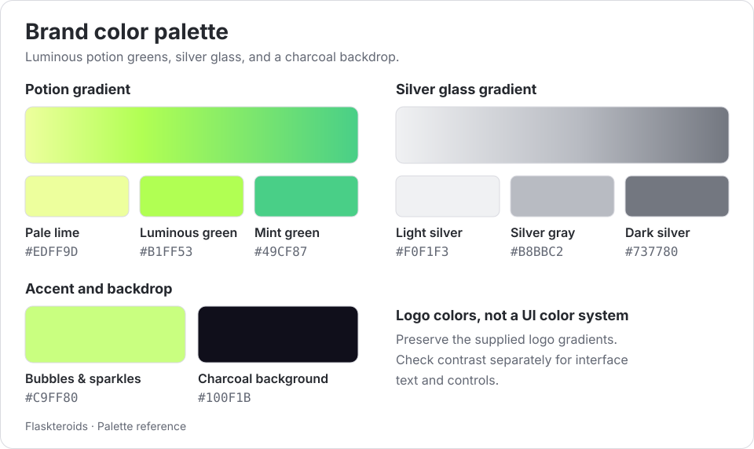
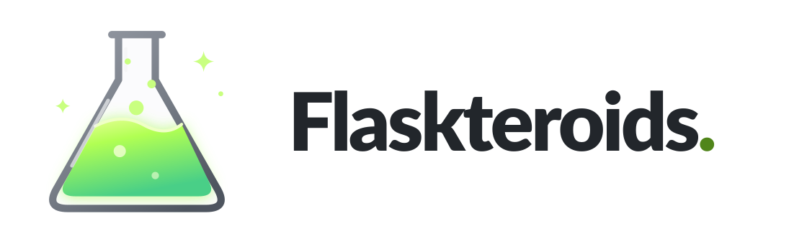
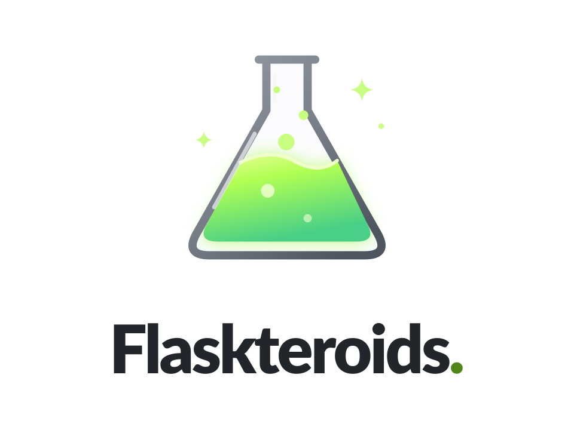
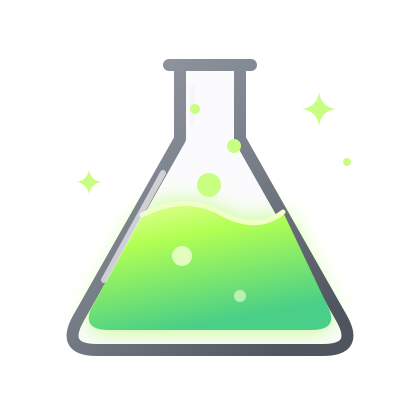
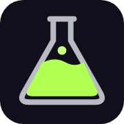
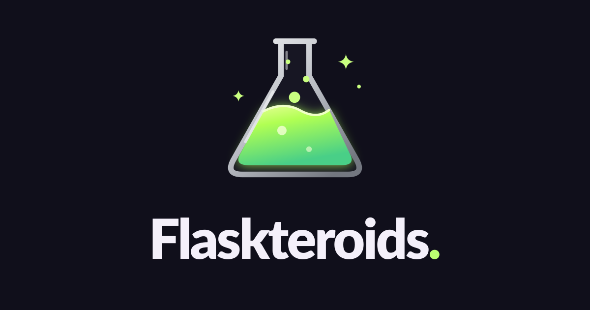

# Flaskteroids brand preview

Silver-gray glass. Luminous green potion. No slogans.

[Asset guide and downloads](README.md) · [Color palette](#brand-color-palette) ·
[Logos](#logos) · [Icons](#icons) · [Social card](#social-card)

## Brand color palette

| Role | Colors |
| --- | --- |
| Potion gradient | Pale lime `#EDFF9D` → luminous green `#B1FF53` → mint green `#49CF87` |
| Bubbles and sparkles | `#C9FF80` |
| Silver glass gradient | Light silver `#F0F1F3` → silver gray `#B8BBC2` → dark silver `#737780` |
| Charcoal presentation background | `#100F1B` |

These are logo colors, not a complete interface color system. Preserve the
supplied gradients and check contrast separately for interface text and controls.
Use the supplied monochrome artwork for single-color applications.

## Logos

The previews below choose the appropriate artwork for your light or dark theme.
Both background variants are available through the download links. The SVG and
PNG logos have transparent backgrounds.

### Horizontal

<picture>
  <source media="(prefers-color-scheme: dark)" srcset="logo-horizontal-dark.svg">
  
</picture>

Dark background: [SVG](logo-horizontal-dark.svg) / [PNG](logo-horizontal-dark.png) ·
Light background: [SVG](logo-horizontal-light.svg) / [PNG](logo-horizontal-light.png)

### Stacked

<picture>
  <source media="(prefers-color-scheme: dark)" srcset="logo-stacked-dark.svg">
  
</picture>

Dark background: [SVG](logo-stacked-dark.svg) / [PNG](logo-stacked-dark.png) ·
Light background: [SVG](logo-stacked-light.svg) / [PNG](logo-stacked-light.png)

### Wordmark

<picture>
  <source media="(prefers-color-scheme: dark)" srcset="wordmark-dark.svg">
  
</picture>

Dark background: [SVG](wordmark-dark.svg) / [PNG](wordmark-dark.png) ·
Light background: [SVG](wordmark-light.svg) / [PNG](wordmark-light.png)

The wordmark uses outlined lettering based on Lato Black; no installed fonts or
external resources are required to display the logo.

## Icons

### Full icon

<picture>
  <source media="(prefers-color-scheme: dark)" srcset="icon.svg">
  
</picture>

Dark background: [SVG](icon.svg) / [PNG](icon.png) ·
Light background: [SVG](icon-light.svg) / [PNG](icon-light.png)

### Monochrome

<picture>
  <source media="(prefers-color-scheme: dark)" srcset="icon-mono-white.svg">
  
</picture>

White ink: [SVG](icon-mono-white.svg) / [PNG](icon-mono-white.png) ·
Dark ink: [SVG](icon-mono-black.svg) / [PNG](icon-mono-black.png)

### Small sizes

| Simplified icon · 64px | Favicon · 32px | Favicon · 48px | Touch icon · 180px asset |
| --- | --- | --- | --- |
|  |  |  |  |
| [SVG](icon-small.svg) / [PNG](icon-small.png) | [PNG](favicon-32.png) | [SVG](favicon.svg) / [PNG](favicon.png) | [PNG](apple-touch-icon.png) |

Use the simplified icon at 64px and below. It removes blur, sparkles, and fine
details for legibility. Favicons and the touch icon include a charcoal background.

## Social card

1200 × 630 · [SVG](social-card.svg) / [PNG](social-card.png)

See the [asset guide](README.md#usage) for clear space, background selection, and
logo usage rules.
